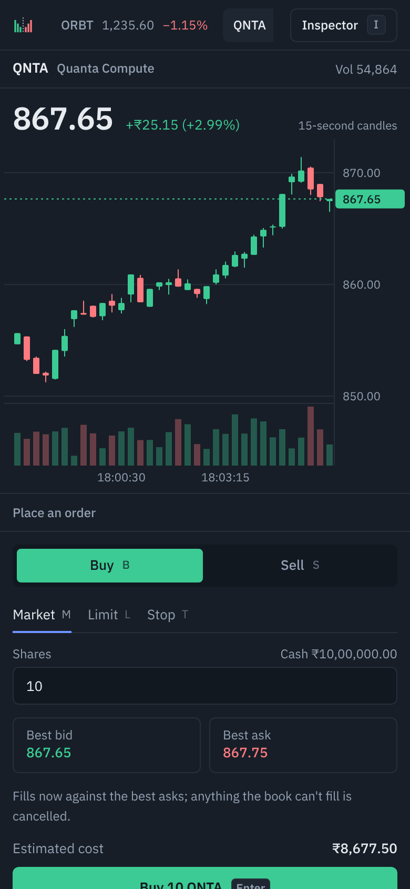
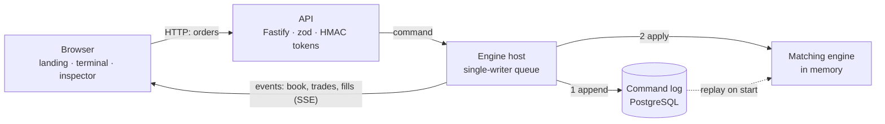

# MarketLab

**A stock exchange you can watch work.** Place an order against a live order
book of simulated traders, then follow it through the system — validated,
written to Postgres, matched by a price-time priority engine, settled — down to
the microseconds each step took.


## Highlights

- **A real matching engine.** Price-time priority, limit, market and stop
  orders, partial fills, stop cascades, self-trade prevention and balance
  reservations, in a pure, deterministic TypeScript library.
- **Proven invariants.** Property-based tests run thousands of random order
  sequences and check after every command that money is conserved and the book
  never crosses. The live server runs the same audit on every health check.
- **Durable by replay.** Every user command is written to a Postgres command
  log before it is applied. On restart the server replays the log and arrives at
  exactly the same state. A database lock guarantees a single writer.
- **Live everywhere.** Prices, the book, trades and your own fills stream over
  server-sent events, with coalesced book updates and slow-client protection.
- **An engine inspector.** For any order: when the API received it, how long it
  queued, how long the durable write took, how long matching took, and every
  event it caused.
- **A terminal built for the keyboard.** Candlestick chart, depth ladder,
  click-to-price, `B`/`S`/`L`/`M`/`T`/`Enter` order entry, positions with
  average-cost P&L. Works on a phone.

## Screens

| Trading terminal                                                                        | Engine inspector                                                                 |
| --------------------------------------------------------------------------------------- | -------------------------------------------------------------------------------- |
|  |  |

| Landing page                                                                     | Phone                                                                           |
| -------------------------------------------------------------------------------- | ------------------------------------------------------------------------------- |
|  |  |

## Architecture



An order's path:

1. The API authenticates the guest token and validates the body with the same
   zod schema the web app uses.
2. The engine host queues the command behind earlier ones. One writer means
   the engine never sees two inputs at once.
3. The command is appended to the Postgres log. If that fails, it is not applied.
4. The engine matches it in memory, in microseconds, and emits events.
5. Read models fold the events into candles, the tape, P&L and order traces,
   and the stream pushes them to every open screen.

## Design decisions

| Decision                                           | Why                                                                                          | Record                                                                     |
| -------------------------------------------------- | -------------------------------------------------------------------------------------------- | -------------------------------------------------------------------------- |
| TypeScript workspaces, legacy app retired in steps | Every merge left a working app                                                               | [ADR 0001](docs/adr/0001-typescript-workspaces-and-strangler-migration.md) |
| Money as integer paise                             | Floats can't represent ₹0.10 exactly; conservation must be exact                             | [ADR 0002](docs/adr/0002-integer-money.md)                                 |
| Single-threaded, deterministic engine              | No locks, reproducible bugs, exact replay                                                    | [ADR 0003](docs/adr/0003-matching-engine.md)                               |
| Log commands, not state                            | Thousands of rows per session instead of millions; bot activity is regenerated from the seed | [ADR 0004](docs/adr/0004-command-log.md)                                   |
| Hand-drawn SVG chart, no chart library             | Small data, full control, and the drawing rules are worth showing                            | [PriceChart.tsx](apps/web/src/terminal/PriceChart.tsx)                     |
| Server-sent events over WebSockets                 | Market data flows one way; commands are plain HTTP                                           | [stream.ts](apps/api/src/stream.ts)                                        |

Design system and references: [docs/DESIGN-DIRECTION.md](docs/DESIGN-DIRECTION.md).

## Quality

| Layer                        | What is tested                                                                                                                                                  |
| ---------------------------- | --------------------------------------------------------------------------------------------------------------------------------------------------------------- |
| Engine (Vitest + fast-check) | Every matching rule; invariants after every random command; determinism; deliberately broken code fails the suite                                               |
| API                          | Exact state after replay (in memory and Postgres), write-ahead failure, single-writer lock (real Postgres in CI), HTTP contract, auth, rate limits, live stream |
| Web (Testing Library)        | Order ticket keyboard, validation, results; stream reducer; formatting                                                                                          |
| End to end (Playwright)      | Hero order trace, place/trace/cancel in the terminal, rejection message, routing, phone layout                                                                  |

CI runs typecheck, lint (`typescript-eslint` strict), formatting, all tests
against Postgres 16, the production build, and Playwright on every pull request.

**Engine benchmark** (`npm run bench -w @marketlab/engine`, one core): about
700,000 commands per second; per-command latency p50 0.6 µs, p99 about 3 µs.
In the running system the Postgres write, not matching, sets the latency, and
the inspector shows both.

## Run it locally

Requires Node 22. Postgres is optional: without `DATABASE_URL` the command log
is kept in memory.

```bash
npm install
npm run dev:api     # API and engine on :8080
npm run dev:web     # web app on :5173, proxying /api to :8080
```

To run with Postgres, copy [`apps/api/.env.example`](apps/api/.env.example) to
`apps/api/.env` and set `DATABASE_URL`.

| Command         | Does                                                          |
| --------------- | ------------------------------------------------------------- |
| `npm run check` | Typecheck, lint, format check, all unit and integration tests |
| `npm run e2e`   | Builds the app and runs the Playwright suite against it       |
| `npm run build` | Production build of every package                             |
| `npm start`     | Runs the built API, serving the built web app                 |

Deployment: [DEPLOYMENT.md](DEPLOYMENT.md).

## Project structure

```
packages/
  engine/      Matching engine, order book, accounts, market simulator (pure)
  contracts/   API request schemas and response types, shared by API and web
apps/
  api/         Engine host, command log, read models, REST, SSE, auth
  web/         Landing page, trading terminal, engine inspector
docs/          Design direction, architecture decision records, screenshots
```

## What is simulated

The four listed companies are fictional and their prices come from seeded bot
traders. Money is play money: each visitor gets a guest account with
₹10,00,000 and no signup. The market resets every 24 hours. There are no fees,
short selling, order amendment or time-in-force options yet.

## Author

Designed and built by Udit Singh Chauhan.
