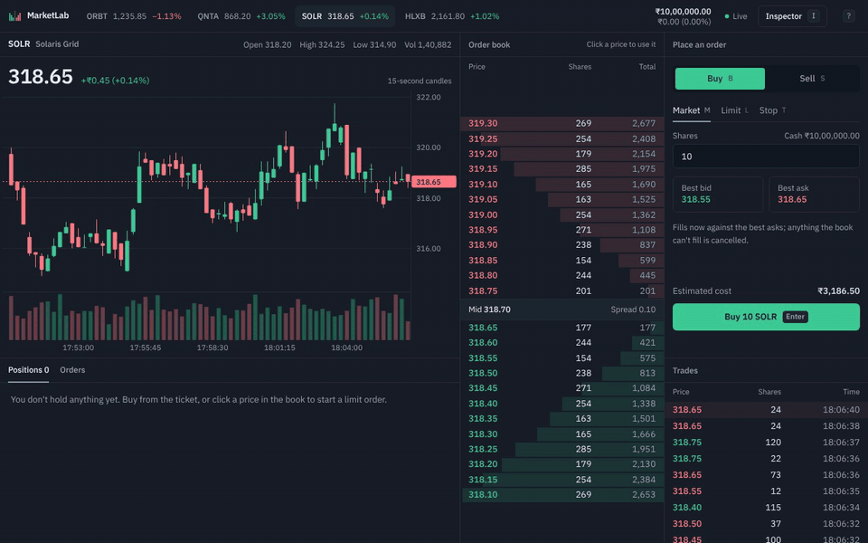
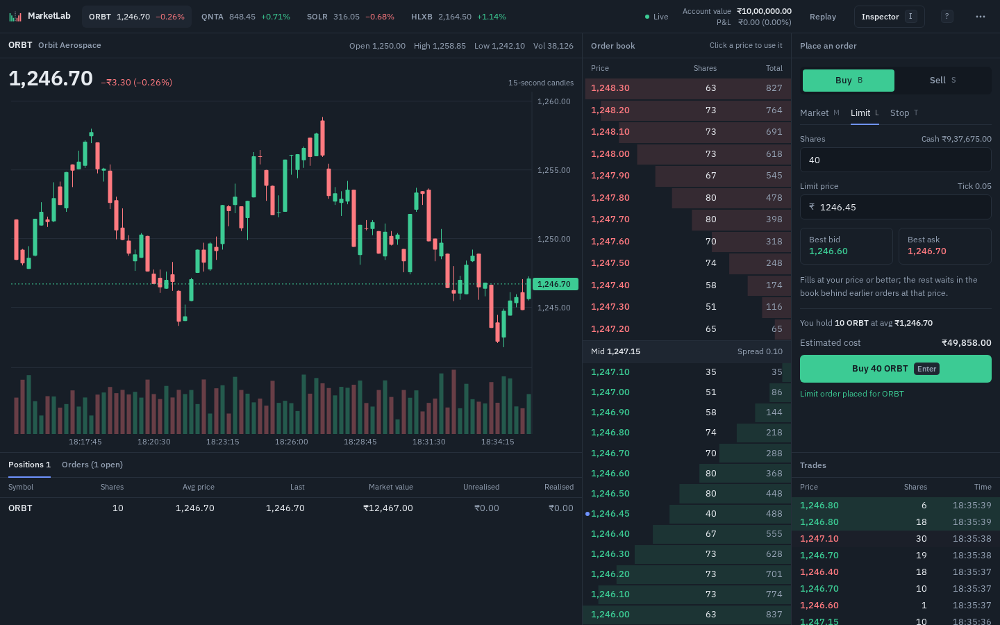
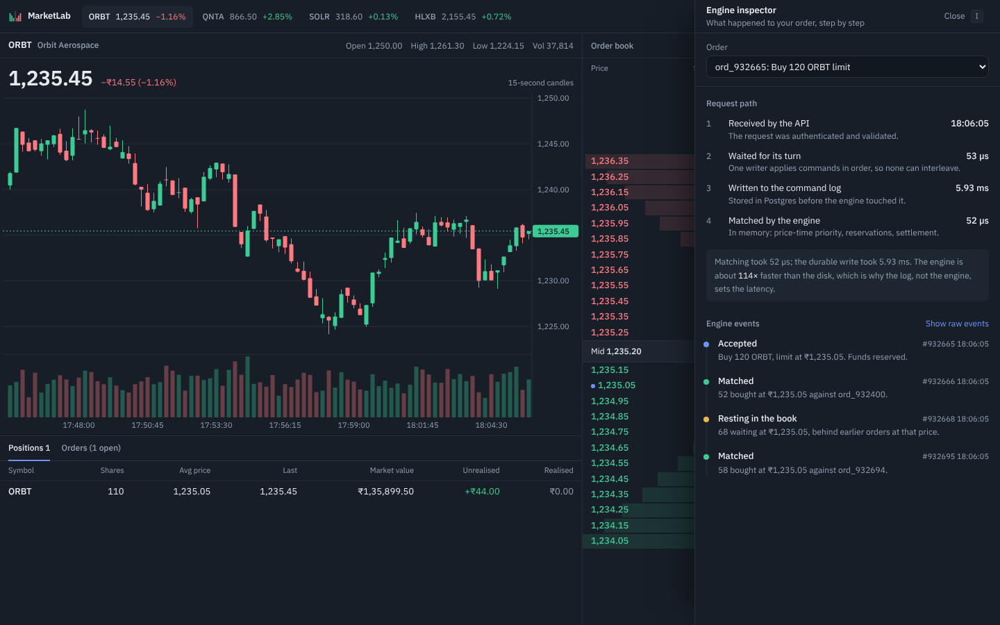
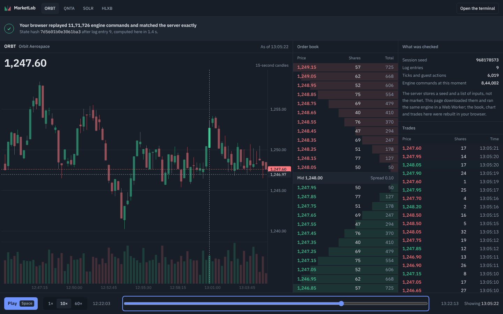
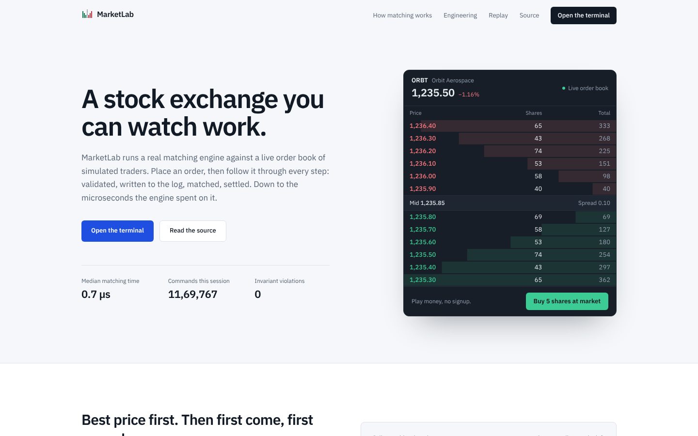
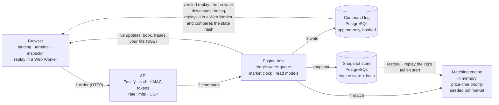

# MarketLab

[](https://github.com/UditSinghChauhan/MarketLab/actions/workflows/ci.yml)

**A stock exchange you can watch work.** Place an order against a live order
book of simulated traders, then follow it through the system — validated,
written to Postgres, matched by a price-time priority engine, settled — down to
the microseconds each step took.



## Highlights

- **A real matching engine.** Price-time priority, limit, market and stop
  orders, partial fills, stop cascades, self-trade prevention and balance
  reservations, in a pure, deterministic TypeScript library.
- **Proven invariants.** Property-based tests run thousands of random order
  sequences and check after every command that money is conserved and the book
  never crosses. The live server runs the same audit on every health check.
- **Durable by replay.** Every user command is written to a Postgres command
  log before it is applied. On restart the server replays the log and arrives at
  exactly the same state. A database lock guarantees a single writer, and
  hash-checked snapshots keep a restart under a second however long the session.
- **Verifiable in your browser.** The [replay page](apps/web/src/replay/Replay.tsx)
  downloads the session's seed and command log, re-runs the same engine in a Web
  Worker, and compares state hashes with the server after every log entry. Then
  it scrubs through the session.
- **Live everywhere.** Prices, the book, trades and your own fills stream over
  server-sent events, with coalesced book updates and slow-client protection.
- **An engine inspector.** For any order: when the API received it, how long it
  queued, how long the durable write took, how long matching took, and every
  event it caused.
- **A terminal built for the keyboard.** Candlestick chart, depth ladder,
  click-to-price, `B`/`S`/`L`/`M`/`T`/`Enter` order entry, positions with
  average-cost P&L. Works on a phone.

## Screens

| Trading terminal                                                                        | Engine inspector                                                                 |
| --------------------------------------------------------------------------------------- | -------------------------------------------------------------------------------- |
|  |  |

| Verified replay                                                                                                 |
| --------------------------------------------------------------------------------------------------------------- |
|  |

| Landing page                                                                     | Phone                                                                           |
| -------------------------------------------------------------------------------- | ------------------------------------------------------------------------------- |
|  |  |

## Architecture



An order's path:

1. The API authenticates the guest token and validates the body with the same
   zod schema the web app uses.
2. The engine host queues the command behind earlier ones. One writer means
   the engine never sees two inputs at once. If the order carries a
   `clientOrderId` the account has already used, it stops here: the answer is
   the first order's outcome, marked `"replayed": true`, and nothing is logged.
   Its current view comes along while the order is still in the account's last
   200; after that the answer has `"order": null`, and is still not a new order.
3. The command is appended to the Postgres log. If that fails, it is not applied.
   One outcome is unknown: if the connection drops after the database committed
   the write but before it replied, the visitor gets `503`, yet the order exists
   after the restart. The web app says so, and resending the order unchanged
   from the same open order form reuses its `clientOrderId`, so it is not
   placed twice. The id lives only in that form: after a reload or a market
   switch, a resend gets a new id and would place the order again.
4. The engine matches it in memory, in microseconds, and emits events.
5. Read models fold the events into candles, the tape, P&L and order traces,
   and the stream pushes them to every open screen.

## Design decisions

| Decision                                                | Why                                                                                                                                                                                                           | Record                                                                     |
| ------------------------------------------------------- | ------------------------------------------------------------------------------------------------------------------------------------------------------------------------------------------------------------- | -------------------------------------------------------------------------- |
| TypeScript workspaces, legacy app retired in steps      | Every merge left a working app                                                                                                                                                                                | [ADR 0001](docs/adr/0001-typescript-workspaces-and-strangler-migration.md) |
| Money as integer paise                                  | Floats can't represent ₹0.10 exactly; conservation must be exact                                                                                                                                              | [ADR 0002](docs/adr/0002-integer-money.md)                                 |
| Single-threaded, deterministic engine                   | No locks, reproducible bugs, exact replay                                                                                                                                                                     | [ADR 0003](docs/adr/0003-matching-engine.md)                               |
| Log commands, not state                                 | Thousands of rows per session instead of millions; bot activity is regenerated from the seed                                                                                                                  | [ADR 0004](docs/adr/0004-command-log.md)                                   |
| Client order ids, at most once per id, not exactly-once | A retry after a lost reply is answered with the first order instead of placing another, within a session and the account's last 500 ids; an order that never reached the log is not placed until it is resent | [ADR 0004](docs/adr/0004-command-log.md)                                   |
| Snapshots bound startup time                            | Replaying a day of ticks takes about a minute; a hashed snapshot plus the log's tail takes half a second                                                                                                      | [ADR 0006](docs/adr/0006-startup-budget-and-snapshots.md)                  |
| The database idles when nobody is watching              | No writes and no open connection while idle, so a free serverless database lasts the month; users lose nothing                                                                                                | [ADR 0007](docs/adr/0007-idle-aware-persistence.md)                        |
| Hand-drawn SVG chart, no chart library                  | Small data, full control, and the drawing rules are worth showing                                                                                                                                             | [PriceChart.tsx](apps/web/src/terminal/PriceChart.tsx)                     |
| Server-sent events over WebSockets                      | Market data flows one way; commands are plain HTTP                                                                                                                                                            | [stream.ts](apps/api/src/stream.ts)                                        |
| The browser can check the server                        | The inputs are public and the engine is pure, so the claim "state is a function of the log" is testable by anyone                                                                                             | [ADR 0005](docs/adr/0005-verified-replay.md)                               |
| Scaling beyond one server (design only)                 | The log append, not matching, is the first limit; partition by symbol, one writer each, and fan out separately                                                                                                | [ADR 0008](docs/adr/0008-scaling-beyond-one-server.md)                     |

Design system and references: [docs/DESIGN-DIRECTION.md](docs/DESIGN-DIRECTION.md).

## Quality

| Layer                        | What is tested                                                                                                                                                                                                                                                                                                                                                                                                                                                                                                                                                                                                                                                                                                                                          |
| ---------------------------- | ------------------------------------------------------------------------------------------------------------------------------------------------------------------------------------------------------------------------------------------------------------------------------------------------------------------------------------------------------------------------------------------------------------------------------------------------------------------------------------------------------------------------------------------------------------------------------------------------------------------------------------------------------------------------------------------------------------------------------------------------------- |
| Engine (Vitest + fast-check) | Every matching rule; invariants after every random command; determinism; state hash and snapshot properties; replayer scrubbing and divergence detection; deliberately broken code fails the suite                                                                                                                                                                                                                                                                                                                                                                                                                                                                                                                                                      |
| API                          | Exact state after replay (in memory and Postgres), snapshot restore equal to full replay, corrupt snapshots ignored, an independent replayer over HTTP reaching the server's hash, write-ahead failure, single-writer lock (real Postgres in CI), persistence failures on the built server against real Postgres (connection killed, reply lost after commit, corrupt stored snapshot, two processes starting at once, waking with the database unreachable), client order ids (a retry answered with the first order after a lost reply, a restart and a snapshot restore; reuse with other details refused), connection-string parsing, TLS verification and channel binding (Postgres with TLS in CI), HTTP contract, auth, rate limits, live stream |
| Web (Testing Library)        | Order ticket keyboard, validation, results; market stream (reducer, reconnect, session expiry); terminal session, toasts and shortcuts; order wording; cold-start monitor; error boundary; formatting                                                                                                                                                                                                                                                                                                                                                                                                                                                                                                                                                   |
| End to end (Playwright)      | Hero order trace, place/trace/cancel in the terminal, an order whose response is lost then resent (placed once, in the hero and the terminal), rejection message, routing, phone layout, cold start, keyboard focus, no layout shift, no console errors, axe (no serious or critical violations), verified replay (match, scrub, play, tampered log)                                                                                                                                                                                                                                                                                                                                                                                                    |

**Unit line coverage: 87%** of TypeScript modules (`npm run coverage`; React
components are covered end to end by Playwright). CI publishes the full report
as a build artifact.

CI runs typecheck, lint (`typescript-eslint` strict), formatting, all tests
with coverage against Postgres 16, the TLS tests against a Postgres with TLS
and a throwaway CA (failing if they are skipped), the production build, a
smoke test of the built server against Postgres (health, JSON 404, deep links,
headers, compression, restart from a snapshot, exit when the log is
unwritable), and Playwright on every pull request.

### Engine time, and what each number measures

All of these time `Exchange.submit` alone, the matching engine's work for one
command.

| Measured                                                                          | Median     | Where                                                              |
| --------------------------------------------------------------------------------- | ---------- | ------------------------------------------------------------------ |
| Bot flow in a tight loop: about 700,000 commands per second, one core             | 0.6 µs     | `npm run bench -w @marketlab/engine`                               |
| A bot command in the running server (98 % are quotes or cancels that never trade) | 0.6–1 µs   | `/api/health` `engine.bots`, landing page                          |
| A visitor's 5-share market order, run hot, back to back                           | 1.1–1.3 µs | `npm run bench:latency -w @marketlab/api`                          |
| The same order right after a 5 ms log write, as in the running server             | 19–23 µs   | the same benchmark; the inspector; `/api/health` `engine.visitors` |

The same order takes about 20 times longer after the write, with the same
engine code: only what happened before it differs. That points to the CPU
having gone cold while the thread waited (caches and branch predictors
refilled by other work, a sleeping core clocking down), not to extra work in
the engine; spinning instead of sleeping for those 5 ms still leaves it at
about 13 µs. A visitor's order in the running system spends milliseconds in
the Postgres write and microseconds in matching, and the inspector shows both.

## Security

MarketLab holds no personal data: no sign-up, no email, no real money. What
it protects is the shared market, from abuse and from forged requests.

- **Guest tokens** are HMAC-SHA256 signed, name one account in one market
  session, and expire after 24 hours or when the session rolls over. The
  browser keeps its token in `localStorage`; the Content Security Policy
  allows scripts from the site itself only.
- **Every request body is validated** (zod, 16 KB limit), and someone else's
  order is reported as missing, so order ids cannot be probed.
- **Rate limits** key on the visitor's address. No proxy header is trusted by
  default: `X-Forwarded-For` and `X-Forwarded-Host` are ignored, so a client
  cannot pose as many visitors. Behind a proxy, `CLIENT_IP_HEADER` names the
  one header the proxy sets, once checked on the live service
  ([DEPLOYMENT.md](DEPLOYMENT.md#check-the-client-address-header)). Limits are
  kept in memory, per process.
- **Each market session accepts at most `MAX_GUESTS_PER_SESSION` guests**
  (500). Past it, a new visitor is told "The demo is full until the market
  resets". This limits the number of accounts only. It does **not** bound the
  snapshot or the command log: those grow with orders, which nothing caps
  except the per-address rate limit (about 0.7 KB of snapshot per order;
  `npm run bench:guests -w @marketlab/api`).
- **Logs** never contain tokens (the event stream's token is removed from
  logged URLs) or client addresses.
- **Headers:** CSP, `X-Frame-Options: DENY`, `nosniff`, a strict referrer
  policy, and HSTS in production. Link previews take the site's address from
  configuration, never from request headers.
- **The database connection** verifies Neon's TLS certificate and host name
  and uses SCRAM channel binding.
- **Public by design:** the command log is readable by anyone, for verified
  replay. It identifies visitors only by opaque guest ids.

## Run it locally

Requires Node 22+ (`nvm use` reads [`.nvmrc`](.nvmrc)).

**In memory** (no database; the market starts fresh on every restart):

```bash
npm install
npm run dev         # API and engine on :8080, web app on http://localhost:5173
```

**With Postgres** (the command log survives restarts; needs Docker):

```bash
npm install
npm run db:up       # Postgres 16 in Docker, waits until it is healthy
npm run dev:pg      # the same two servers, logging to that database
```

`npm run db:down` stops the database and keeps its data. To point at another
database, set `DATABASE_URL` in the shell or in `apps/api/.env` (see
[`apps/api/.env.example`](apps/api/.env.example)). `npm run dev:api` and
`npm run dev:web` start the two servers separately.

| Command         | Does                                                                                    |
| --------------- | --------------------------------------------------------------------------------------- |
| `npm run check` | Typecheck, lint, format check, all unit and integration tests                           |
| `npm run e2e`   | Builds the app and runs the Playwright suite against it, including accessibility checks |
| `npm run build` | Production build of every package                                                       |
| `npm start`     | Runs the built API, serving the built web app                                           |

Deployment: [DEPLOYMENT.md](DEPLOYMENT.md).

## Project structure

```
packages/
  engine/      Matching engine, order book, accounts, market simulator, session
               engine and replayer (pure: no I/O, no clock)
  contracts/   API request schemas and response types, shared by API and web
apps/
  api/         Engine host, command log, read models, REST, SSE, auth
  web/         Landing page, trading terminal, engine inspector, verified replay
docs/          Design direction, architecture decision records, screenshots
```

## What is simulated

The four listed companies are fictional and their prices come from seeded bot
traders. Money is play money: each visitor gets a guest account with
₹10,00,000 and no signup. There are no fees, short selling, order amendment or
time-in-force options yet.

**Market sessions.** A session is one simulated trading day. Once it is 24
hours old (`SESSION_HOURS`), it ends at the first quiet moment: when nobody
has had the site open or traded for five minutes. A restart after that age
ends it too. While people keep using the site, it carries on past 24 hours. A
fresh session starts with new bot traders and half an hour of simulated
history. **Guest accounts, balances and open orders end with the old
session**: it is play money, and a returning visitor simply gets a new
account. The old session's command log is kept for seven days.

## Author

Designed and built by Udit Singh Chauhan.

- GitHub: [UditSinghChauhan](https://github.com/UditSinghChauhan)
- LinkedIn: [Udit Singh](https://www.linkedin.com/in/udit-singh-31382137a/)
- Email: [uditsinghchauhan720@gmail.com](mailto:uditsinghchauhan720@gmail.com)

## License

[MIT](LICENSE)
