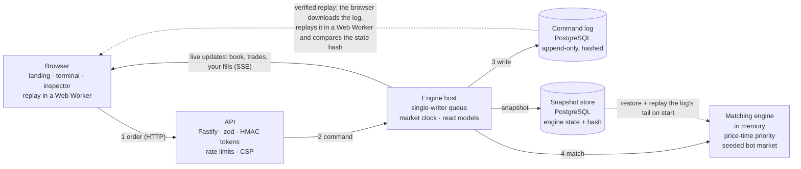

# MarketLab

[](https://github.com/UditSinghChauhan/MarketLab/actions/workflows/ci.yml)

**A stock exchange you can watch work.** Place an order against a live order
book of simulated traders, then follow it through the system — validated,
written to Postgres, matched by a price-time priority engine, settled — down to
the microseconds each step took.


## Highlights

- **A real matching engine.** Price-time priority, limit, market and stop
  orders, partial fills, stop cascades, self-trade prevention and balance
  reservations, in a pure, deterministic TypeScript library.
- **Proven invariants.** Property-based tests run thousands of random order
  sequences and check after every command that money is conserved and the book
  never crosses. The live server runs the same audit on every health check.
- **Durable by replay.** Every user command is written to a Postgres command
  log before it is applied. On restart the server replays the log and arrives at
  exactly the same state. A database lock guarantees a single writer, and
  hash-checked snapshots keep a restart under a second however long the session.
- **Verifiable in your browser.** The [replay page](apps/web/src/replay/Replay.tsx)
  downloads the session's seed and command log, re-runs the same engine in a Web
  Worker, and compares state hashes with the server after every log entry. Then
  it scrubs through the session.
- **Live everywhere.** Prices, the book, trades and your own fills stream over
  server-sent events, with coalesced book updates and slow-client protection.
- **An engine inspector.** For any order: when the API received it, how long it
  queued, how long the durable write took, how long matching took, and every
  event it caused.
- **A terminal built for the keyboard.** Candlestick chart, depth ladder,
  click-to-price, `B`/`S`/`L`/`M`/`T`/`Enter` order entry, positions with
  average-cost P&L. Works on a phone.

## Screens

| Trading terminal                                                                        | Engine inspector                                                                 |
| --------------------------------------------------------------------------------------- | -------------------------------------------------------------------------------- |
|  |  |

| Verified replay                                                                                                 |
| --------------------------------------------------------------------------------------------------------------- |
|  |

| Landing page                                                                     | Phone                                                                           |
| -------------------------------------------------------------------------------- | ------------------------------------------------------------------------------- |
|  |  |

## Architecture



An order's path:

1. The API authenticates the guest token and validates the body with the same
   zod schema the web app uses.
2. The engine host queues the command behind earlier ones. One writer means
   the engine never sees two inputs at once.
3. The command is appended to the Postgres log. If that fails, it is not applied.
4. The engine matches it in memory, in microseconds, and emits events.
5. Read models fold the events into candles, the tape, P&L and order traces,
   and the stream pushes them to every open screen.

## Design decisions

| Decision                                           | Why                                                                                                               | Record                                                                     |
| -------------------------------------------------- | ----------------------------------------------------------------------------------------------------------------- | -------------------------------------------------------------------------- |
| TypeScript workspaces, legacy app retired in steps | Every merge left a working app                                                                                    | [ADR 0001](docs/adr/0001-typescript-workspaces-and-strangler-migration.md) |
| Money as integer paise                             | Floats can't represent ₹0.10 exactly; conservation must be exact                                                  | [ADR 0002](docs/adr/0002-integer-money.md)                                 |
| Single-threaded, deterministic engine              | No locks, reproducible bugs, exact replay                                                                         | [ADR 0003](docs/adr/0003-matching-engine.md)                               |
| Log commands, not state                            | Thousands of rows per session instead of millions; bot activity is regenerated from the seed                      | [ADR 0004](docs/adr/0004-command-log.md)                                   |
| Snapshots bound startup time                       | Replaying a day of ticks takes about a minute; a hashed snapshot plus the log's tail takes half a second          | [ADR 0006](docs/adr/0006-startup-budget-and-snapshots.md)                  |
| Hand-drawn SVG chart, no chart library             | Small data, full control, and the drawing rules are worth showing                                                 | [PriceChart.tsx](apps/web/src/terminal/PriceChart.tsx)                     |
| Server-sent events over WebSockets                 | Market data flows one way; commands are plain HTTP                                                                | [stream.ts](apps/api/src/stream.ts)                                        |
| The browser can check the server                   | The inputs are public and the engine is pure, so the claim "state is a function of the log" is testable by anyone | [ADR 0005](docs/adr/0005-verified-replay.md)                               |

Design system and references: [docs/DESIGN-DIRECTION.md](docs/DESIGN-DIRECTION.md).

## Quality

| Layer                        | What is tested                                                                                                                                                                                                                                                                                                                                                                             |
| ---------------------------- | ------------------------------------------------------------------------------------------------------------------------------------------------------------------------------------------------------------------------------------------------------------------------------------------------------------------------------------------------------------------------------------------ |
| Engine (Vitest + fast-check) | Every matching rule; invariants after every random command; determinism; state hash and snapshot properties; replayer scrubbing and divergence detection; deliberately broken code fails the suite                                                                                                                                                                                         |
| API                          | Exact state after replay (in memory and Postgres), snapshot restore equal to full replay, corrupt snapshots ignored, an independent replayer over HTTP reaching the server's hash, write-ahead failure, single-writer lock (real Postgres in CI), connection-string parsing, TLS verification and channel binding (Postgres with TLS in CI), HTTP contract, auth, rate limits, live stream |
| Web (Testing Library)        | Order ticket keyboard, validation, results; market stream (reducer, reconnect, session expiry); terminal session, toasts and shortcuts; order wording; cold-start monitor; error boundary; formatting                                                                                                                                                                                      |
| End to end (Playwright)      | Hero order trace, place/trace/cancel in the terminal, rejection message, routing, phone layout, cold start, keyboard focus, no layout shift, no console errors, axe (no serious or critical violations), verified replay (match, scrub, play, tampered log)                                                                                                                                |

**Unit line coverage: 87%** of TypeScript modules (`npm run coverage`; React
components are covered end to end by Playwright). CI publishes the full report
as a build artifact.

CI runs typecheck, lint (`typescript-eslint` strict), formatting, all tests
with coverage against Postgres 16, the TLS tests against a Postgres with TLS
and a throwaway CA (failing if they are skipped), the production build, a
smoke test of the built server against Postgres (health, JSON 404, deep links,
headers, compression, restart from a snapshot, exit when the log is
unwritable), and Playwright on every pull request.

**Engine benchmark** (`npm run bench -w @marketlab/engine`, one core): about
700,000 commands per second; per-command latency p50 0.6 µs, p99 about 3 µs.
In the running system the Postgres write, not matching, sets the latency, and
the inspector shows both.

## Run it locally

Requires Node 22+ (`nvm use` reads [`.nvmrc`](.nvmrc)).

**In memory** (no database; the market starts fresh on every restart):

```bash
npm install
npm run dev         # API and engine on :8080, web app on http://localhost:5173
```

**With Postgres** (the command log survives restarts; needs Docker):

```bash
npm install
npm run db:up       # Postgres 16 in Docker, waits until it is healthy
npm run dev:pg      # the same two servers, logging to that database
```

`npm run db:down` stops the database and keeps its data. To point at another
database, set `DATABASE_URL` in the shell or in `apps/api/.env` (see
[`apps/api/.env.example`](apps/api/.env.example)). `npm run dev:api` and
`npm run dev:web` start the two servers separately.

| Command         | Does                                                                                    |
| --------------- | --------------------------------------------------------------------------------------- |
| `npm run check` | Typecheck, lint, format check, all unit and integration tests                           |
| `npm run e2e`   | Builds the app and runs the Playwright suite against it, including accessibility checks |
| `npm run build` | Production build of every package                                                       |
| `npm start`     | Runs the built API, serving the built web app                                           |

Deployment: [DEPLOYMENT.md](DEPLOYMENT.md).

## Project structure

```
packages/
  engine/      Matching engine, order book, accounts, market simulator, session
               engine and replayer (pure: no I/O, no clock)
  contracts/   API request schemas and response types, shared by API and web
apps/
  api/         Engine host, command log, read models, REST, SSE, auth
  web/         Landing page, trading terminal, engine inspector, verified replay
docs/          Design direction, architecture decision records, screenshots
```

## What is simulated

The four listed companies are fictional and their prices come from seeded bot
traders. Money is play money: each visitor gets a guest account with
₹10,00,000 and no signup. The market resets every 24 hours. There are no fees,
short selling, order amendment or time-in-force options yet.

## Author

Designed and built by Udit Singh Chauhan.

- GitHub: [UditSinghChauhan](https://github.com/UditSinghChauhan)
- LinkedIn: [Udit Singh](https://www.linkedin.com/in/udit-singh-31382137a/)
- Email: [uditsinghchauhan720@gmail.com](mailto:uditsinghchauhan720@gmail.com)

## License

[MIT](LICENSE)
